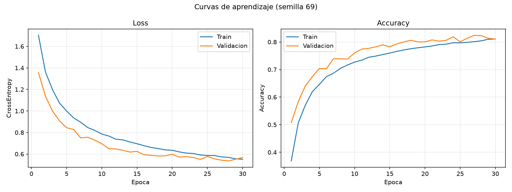
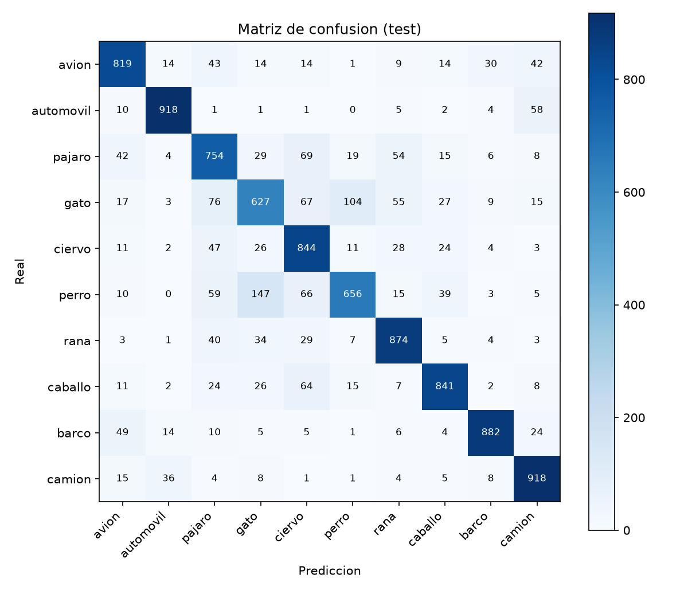

# Clasificación de imágenes CIFAR-10 con CNN (PyTorch)

**Universidad Andina del Cusco — Departamento Académico de Ingeniería de Sistemas**
Evaluación de la Segunda Unidad · Inteligencia Artificial
Código de matrícula: 022100269G · **Semilla individual: 69** (`torch.manual_seed(69)`, `np.random.seed(69)`)

## Estructura

```
cnn-cifar10/
├── src/
│   ├── dataset.py   # carga, transformaciones, partición y visualización (P1)
│   ├── model.py     # arquitectura CNN y validación de shapes (P3)
│   └── train.py     # entrenamiento y evaluación (P4)
├── notebooks/
│   └── experiment.ipynb
├── outputs/
│   ├── loss_accuracy.png
│   ├── confusion_matrix.png
│   ├── samples.png / metrics.json / train_log.txt
└── README.md
```

Ejecución: `pip install -r requirements.txt` y luego `cd src && python train.py`.

## Pregunta 1 — Datos, transformaciones y partición

- **Dataset:** CIFAR-10 (60 000 imágenes RGB 32×32, 10 clases) descargado con `torchvision.datasets`.
- **Semilla 69** aplicada a `random`, `numpy` y `torch` (`set_seed`), y como `random_state` de la partición.
- **Visualización:** `show_samples()` grafica una cuadrícula de 16 imágenes con su etiqueta real (también en el notebook).
- **Transformaciones (train):** `RandomCrop(32, padding=4)`, `RandomHorizontalFlip()`, `ToTensor()`, `Normalize(media, desv. por canal RGB)`. Validación y test solo usan `ToTensor` + `Normalize`.
- **Partición estratificada** (`train_test_split(..., stratify=y)`), impresa en consola:

| Conjunto | Imágenes |
|---|---|
| Entrenamiento | 45 000 |
| Validación | 5 000 |
| Test (independiente) | 10 000 |

Batch de entrenamiento: `X (128, 3, 32, 32)`, `y (128,)`.

## Pregunta 2 — Por qué CNN y no MLP

### Justificación teórica

Una imagen CIFAR-10 tiene 32×32×3 = 3 072 valores. Un MLP la aplana en un vector y conecta cada píxel con cada neurona oculta:

1. **Explosión de parámetros.** Una sola capa oculta de 1 024 neuronas ya necesita 3 072 × 1 024 ≈ 3,1 M de pesos; para imágenes de mayor resolución crece cuadráticamente. Esto lleva a sobreajuste y a un entrenamiento costoso.
2. **Pérdida de la estructura espacial.** Al aplanar, píxeles vecinos y lejanos reciben el mismo trato; la red debe aprender desde cero que la vecindad importa.
3. **Sin invariancia a la traslación.** Si un objeto se desplaza unos píxeles, el vector de entrada cambia por completo y el MLP debe aprender cada posición por separado.

Las CNN resuelven estas limitaciones:

- **Conexiones locales:** cada neurona ve solo un campo receptivo pequeño (3×3), capturando bordes y texturas, y las capas profundas combinan esos patrones en formas y objetos.
- **Weight sharing:** el mismo filtro se aplica en toda la imagen, así que una `Conv2d(3, 32, 3)` usa solo 3·3·3·32 + 32 = 896 parámetros, no millones.
- **Invarianza (equivarianza) espacial:** un patrón se detecta sin importar dónde aparezca, y el `MaxPool2d` aporta tolerancia a pequeños desplazamientos y reduce la resolución.

### Arquitectura implementada

| Capa | Salida (B = batch) | Parámetros |
|---|---|---|
| Entrada | (B, 3, 32, 32) | – |
| Bloque 1: Conv2d(3→32, 3×3, pad 1) + ReLU + MaxPool2d(2) | (B, 32, 16, 16) | 896 |
| Bloque 2: Conv2d(32→64, 3×3, pad 1) + ReLU + MaxPool2d(2) | (B, 64, 8, 8) | 18 496 |
| Bloque 3: Conv2d(64→128, 3×3, pad 1) + ReLU + MaxPool2d(2) | (B, 128, 4, 4) | 73 856 |
| Flatten | (B, 2048) | – |
| Linear(2048→256) + ReLU + Dropout(0.5) | (B, 256) | 524 544 |
| Linear(256→10) | (B, 10) | 2 570 |

Total: **620 362** parámetros entrenables. Cumple el requisito de al menos dos bloques Conv2d + ReLU + MaxPool2d y capas Linear hacia 10 clases.

## Pregunta 3 — Tensores 4D y validación del forward pass

`src/model.py` implementa `CNN.forward()` y usa `nn.Flatten()` entre el último bloque convolucional (128×4×4 = 2048) y la primera capa `Linear`. `validate_shapes()` pasa un batch simulado y verifica con `assert`; salida real:

```
Entrada                 -> (8, 3, 32, 32)
Bloque 1 (Conv+ReLU+MP) -> (8, 32, 16, 16)
Bloque 2 (Conv+ReLU+MP) -> (8, 64, 8, 8)
Bloque 3 (Conv+ReLU+MP) -> (8, 128, 4, 4)
Flatten                 -> (8, 2048)
Linear -> logits        -> (8, 10)
OK: el modelo procesa tensores 4D sin Shape Mismatch.
```

## Pregunta 4 — Entrenamiento, métricas y análisis

**Configuración:** `CrossEntropyLoss`, optimizador `Adam` (lr = 1e-3), batch 128, 30 épocas, CPU. Se guarda el modelo con mejor accuracy de validación (época 27) y se evalúa sobre el test independiente.




| Métrica | Train | Validación | Test |
|---|---|---|---|
| Accuracy (época 30) | 81,06 % | 81,04 % | – |
| Loss (época 30) | 0,552 | 0,567 | – |
| Mejor modelo (época 27) | – | 82,42 % | **81,33 %** (loss 0,552) |

### Análisis crítico (semilla 69)

- **Overfitting: no.** La brecha entre entrenamiento y validación en la última época es de apenas 0,02 puntos de accuracy (81,06 % vs. 81,04 %) y 0,015 en loss. Durante casi todo el entrenamiento la validación estuvo por encima del entrenamiento, algo esperable porque el train usa data augmentation y Dropout (0,5) y la validación no. La loss de validación sube ligeramente en las últimas 3 épocas (0,536 → 0,567), pero sin que se abra una brecha con el entrenamiento: es ruido de las últimas épocas, no una divergencia sostenida.
- **Underfitting leve: sí.** La accuracy de entrenamiento es solo ~81 % y las curvas seguían mejorando lentamente al terminar las 30 épocas. El modelo tiene capacidad y tiempo adicionales para aprender: más épocas, BatchNorm, más filtros o un *scheduler* de la tasa de aprendizaje probablemente subirían el rendimiento por encima del 85 %.
- **Generalización:** el accuracy de test (81,33 %) es consistente con el de validación (82,42 % del mejor modelo; ~1 punto de diferencia por selección del mejor checkpoint sobre validación).
- **Errores por clase:** las mejores clases son *automóvil* (F1 0,921) y *barco* (0,904); las peores *gato* (0,654) y *pájaro* (0,733). Las confusiones más frecuentes son perro → gato (147 casos), gato → perro (104), gato → pájaro (76), pájaro → ciervo (69) y gato → ciervo (67): animales con formas y texturas parecidas a 32×32 píxeles.

Detalle completo por clase en `outputs/train_log.txt` y la evolución por época en `outputs/metrics.json`.
